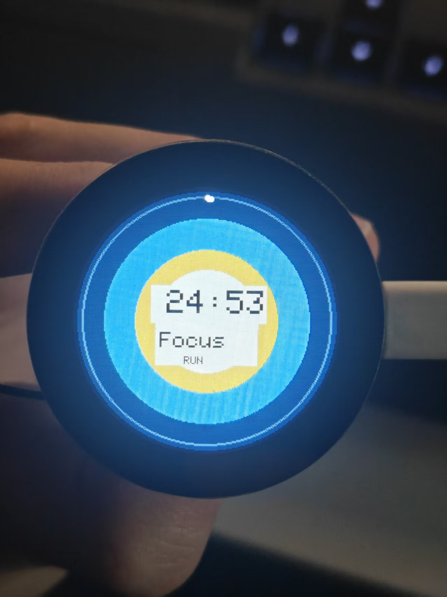
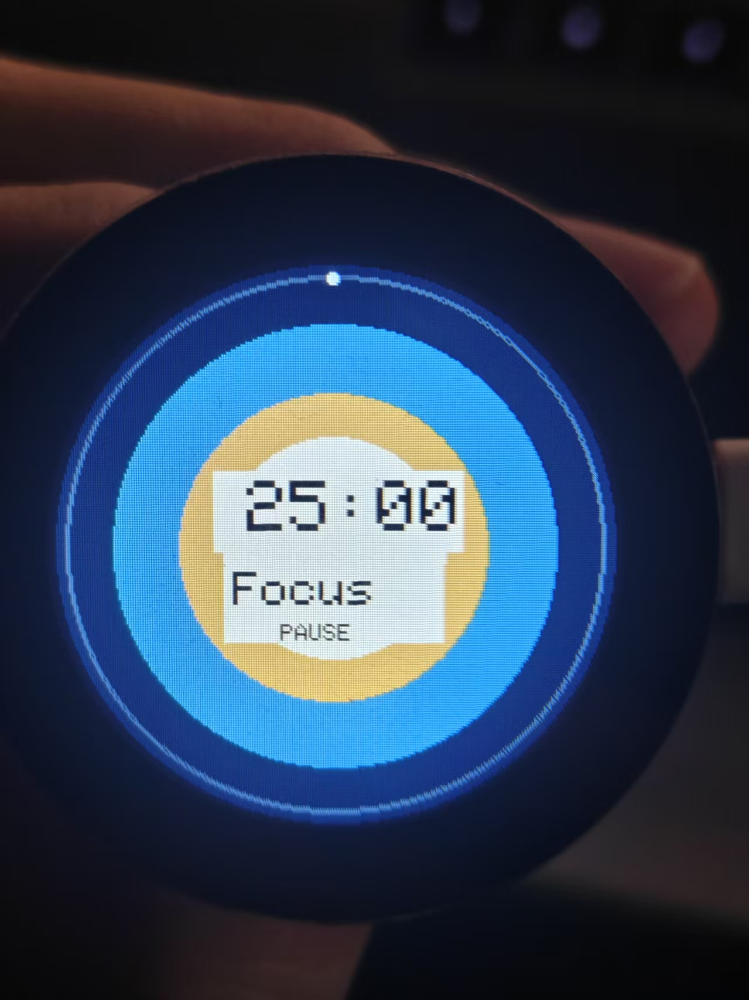
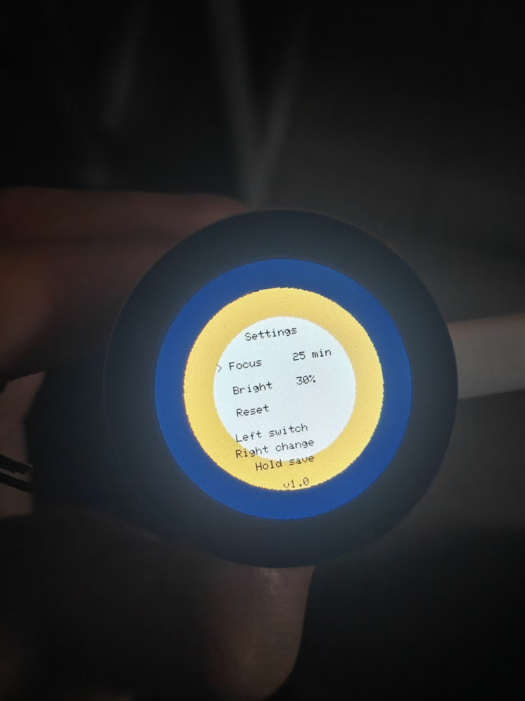
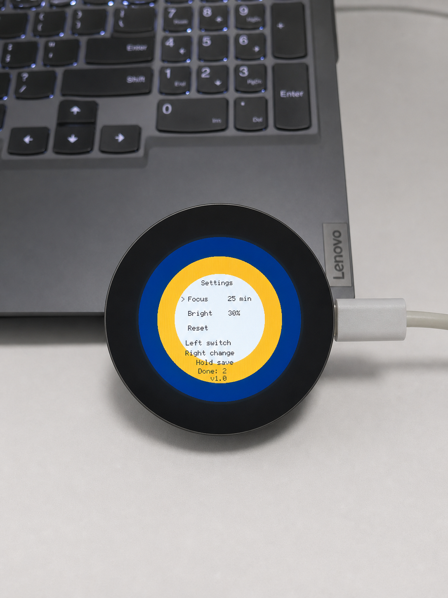
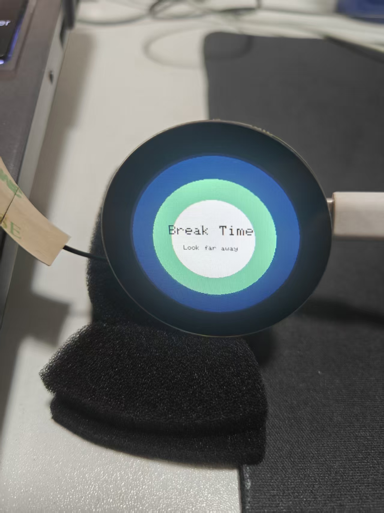
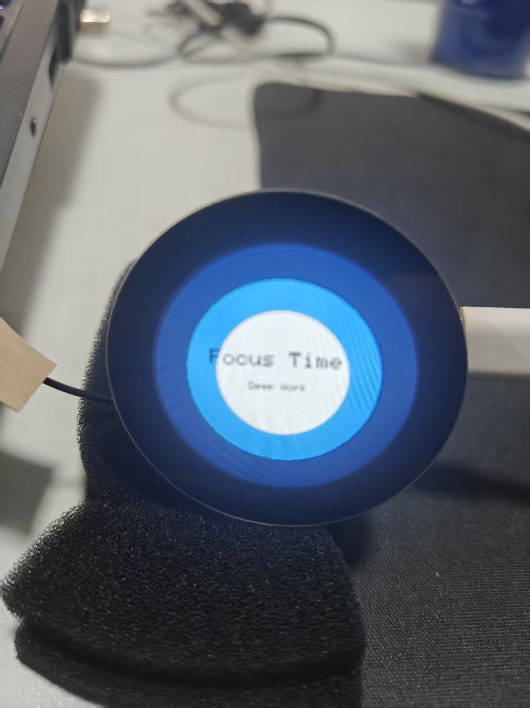
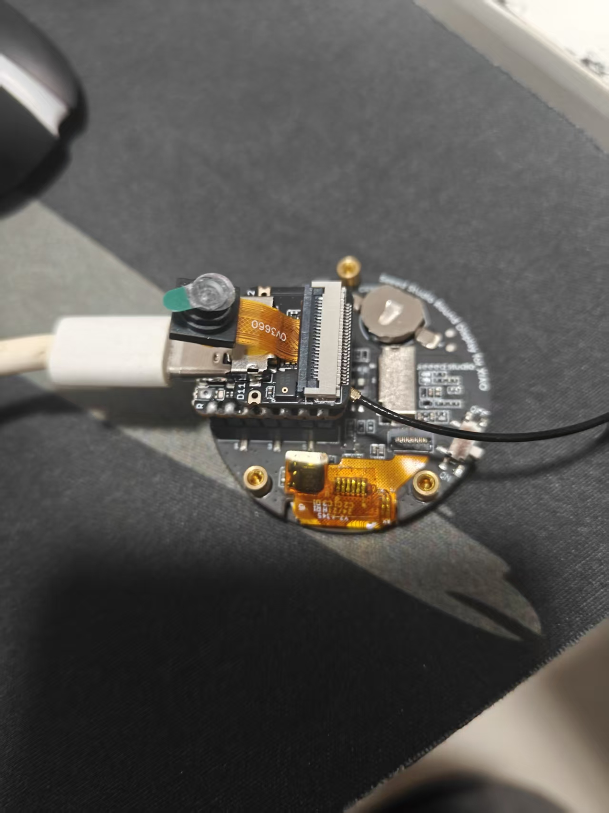

# XIAO Pomodoro Companion

A small Pomodoro desk companion built with a Seeed Studio XIAO ESP32S3 Sense and the Seeed Round Display for XIAO.

The project focuses on a stable embedded workflow first: PlatformIO, Arduino framework, round LCD rendering, touch input, persistent settings, and a simple product-like interaction model.

## Current Status

The current daily-use firmware is **v1.6** on `main`, including the passive PDM microphone sound indicator. Commit `fc32445` updated the displayed version to `v1.6` and synchronized the hardware notes.

The daily hardware setup is the XIAO ESP32S3 Sense with its **Sense expansion board installed**, the Round Display, and USB-C power. The microphone remains available; only the removable camera module is disconnected. The Round Display KE switch is set to ON / KE for backlight control. No battery, microSD card, or RTC coin cell is installed.

The separate `v1.7-camera-test` experiment initialized the camera and captured one frame, but keeping it initialized produced uncomfortable heat. It remains outside `main`; periodic capture was skipped.

The [Flexible Learning Map](docs/esp32-flexible-learning-roadmap.md) connects this project with circuits, mathematics, sound data, embedded systems, FPGA, and AI. It is an evolving map, not a mandatory sequence. The [Engineering Roadmap](docs/roadmap.md) tracks current work and candidate product extensions.

The updated [Project and Learning Plan](docs/xiao-linux-mini-plan.md) separates current tasks, learning exercises, pending validation, and optional branches. The near-term sequence is capture evidence, compare curves, validate the full workflow, then make evidence-led changes. The local `codex/microphone-serial-data` experiment already contains continuous microphone capture and a web monitor; these are not a new daily-use release. The [hardware feedback CLI](docs/hardware-feedback-loop.md) now accepts both legacy Mic records and experimental timestamped CSV. Its checks do not replace human screen, touch, and sound-response checks.

The [October 13 T01 record](docs/experiments/2026-10-13-t01-sound-baseline.md) contains quiet / speech / clap captures. The [October 14 T02 comparison](docs/experiments/2026-10-14-t02-sound-comparison.md) found microphone payloads mixed into I2C error lines. The [October 16 touch-IRQ fix and retest](docs/experiments/2026-10-16-t04-touch-irq-serial.md) now gates coordinate reads on the touch interrupt: two post-upload observations had zero I2C errors and zero mixed records, and the user confirmed basic touch / Settings / Bright / Save operation. The [October 16 quiet retest](docs/experiments/2026-10-16-t05-quiet-retest.md) produced a clean Quiet-only baseline, and the [October 17 clap retest](docs/experiments/2026-10-17-t02-clap-retest.md) closed with an operator-confirmed 13/13 final run. Screen-label sync was confirmed on device on October 17, and the [quiet debounce change](docs/experiments/2026-10-17-t06-quiet-debounce.md) stabilized the Normal label during speech. The [manual Reset / Stats / NVS checks](docs/experiments/2026-10-17-t07-manual-reset-stats-nvs.md) passed the same day. PR #1 was then merged into main on October 17 (`ec5cfe8`). The original FAILED reports are preserved. Full acceptance and PCM / AI remain separate work.

## Hardware

* Seeed Studio XIAO ESP32S3 Sense
* Seeed Studio Round Display for XIAO
* USB-C data cable
* External 2.4 GHz antenna connected to the XIAO ESP32S3 U.FL/IPEX connector

Current development setup does not require a battery, TF card, or RTC coin cell.

## Hardware Notes

The XIAO ESP32S3 Sense is not just a basic ESP32S3 board. The Sense expansion board also includes an onboard camera, a PDM digital microphone, and microSD-related circuitry. These onboard features reserve or share several GPIO pins, so future hardware expansion should be planned carefully.

### Official Pinout References

Seeed Studio maintains official XIAO pinout sheets in the OSHW XIAO Series repository:

* [XIAO ESP32S3 Sense front pinout](https://github.com/Seeed-Studio/OSHW-XIAO-Series/blob/main/pinout/XIAO_ESP32-S3_Sense_front_pinout.png)
* [XIAO ESP32S3 Sense back pinout](https://github.com/Seeed-Studio/OSHW-XIAO-Series/blob/main/pinout/XIAO_ESP32-S3_Sense_back_pinout.png)
* [OSHW XIAO Series pinout directory](https://github.com/Seeed-Studio/OSHW-XIAO-Series/tree/main/pinout)

Use these official pinout sheets as the first reference before adding hardware, changing GPIO assignments, or cutting solder jumpers.

### Currently Used in This Project

This firmware currently uses:

* Round display
* Touch input from the Round Display
* PDM microphone passive sound indicator
* ESP32 internal NVS storage for settings
* USB-C for power, upload, and serial debugging

This firmware currently does **not** use:

* Camera
* microSD card
* External battery
* RTC coin cell
* JTAG debugging

Pomodoro settings such as focus duration and brightness are stored in **ESP32 NVS**, not on a microSD card.

### Microphone Pins

The onboard PDM digital microphone uses:

| Function |   GPIO |
| -------- | -----: |
| PDM DATA | GPIO41 |
| PDM CLK  | GPIO42 |

These pins are also exposed as D12 / D11 on the Sense expansion board, but they are reserved for the onboard microphone by default.

Do not use GPIO41 / GPIO42 for other peripherals unless the microphone is intentionally disabled.

Also note that GPIO41 and GPIO42 should not be treated as ADC-capable analog input pins, even if they appear near analog-style labels in some diagrams.

### Camera Pins

The Sense camera uses several GPIO pins:

| Camera Signal |   GPIO |
| ------------- | -----: |
| XMCLK         | GPIO10 |
| DVP_Y8        | GPIO11 |
| DVP_Y7        | GPIO12 |
| DVP_PCLK      | GPIO13 |
| DVP_Y6        | GPIO14 |
| DVP_Y2        | GPIO15 |
| DVP_Y5        | GPIO16 |
| DVP_Y3        | GPIO17 |
| DVP_Y4        | GPIO18 |
| DVP_VSYNC     | GPIO38 |
| Camera SCL    | GPIO39 |
| Camera SDA    | GPIO40 |
| DVP_HREF      | GPIO47 |
| DVP_Y9        | GPIO48 |

This project does not currently use the camera, but these pins should be considered reserved if camera support is added later.

In the current daily Pomodoro build, only the removable camera module is disconnected; the Sense expansion board stays installed for the microphone. The `v1.7-camera-test` experiment confirmed initialization and single-frame capture, but the initialized-idle test produced uncomfortable heat (subjective grade 3). Periodic capture was skipped. This observation does not establish a defective module or a measured temperature. See the [camera experiment record](https://github.com/iankirkpa5-hash/xiao-pomodoro-companion/blob/v1.7-camera-test/docs/camera-test-v1.7.md). Camera code has not been merged into `main`.

### microSD / SPI Pin Sharing

The Sense expansion board includes microSD-related circuitry that shares SPI-related pins:

| Function   |   GPIO |
| ---------- | -----: |
| microSD CS | GPIO21 |
| SPI SCK    |  GPIO7 |
| SPI MISO   |  GPIO8 |
| SPI MOSI   |  GPIO9 |

The Round Display also depends on display/touch communication, so avoid changing SPI-related hardware configuration unless the full pin map is reviewed.

This project does not currently use the Sense microSD slot.

### Round Display KE Switch

Brightness control depends on the Round Display back-side KE switch. For this firmware, both switch positions should be set to **ON / KE** so the display backlight control path is connected to the XIAO.

With this switch state, the firmware can control the screen backlight through:

```cpp
constexpr int LCD_BL = 43; // XIAO D6 / GPIO43
```

If the Settings `Bright` value changes but the physical screen brightness does not, check the Round Display KE switch first.

### Do Not Cut J1 / J2 / J3 for This Project

The Sense board exposes solder jumpers such as J1, J2, and J3 for advanced hardware configuration.

For this project, do **not** cut or modify these jumpers.

* J1 / J2 are related to the microphone connection on GPIO41 / GPIO42.
* J3 is related to the Sense board's microSD / SPI configuration.
* Cutting these jumpers can disable onboard functions or create hard-to-debug hardware issues.

This project keeps the Sense hardware in its default state.

### Expansion Guidelines

For future expansion:

* Prefer I2C / Grove-style peripherals when possible.
* Avoid GPIO41 / GPIO42 if microphone support may be used later.
* Avoid modifying D8 / D9 / D10 / GPIO21 unless microSD and SPI sharing are fully understood.
* Do not cut J1 / J2 / J3 unless the hardware modification is intentional and documented.
* Keep camera, microphone, and microSD support as separate experimental milestones.

Experiment status and future candidates:

* `v1.6-microphone-test`: completed and merged; centered RMS / peak and Quiet / Normal / Loud are available.
* `feature/camera-test` / `v1.7-camera-test`: recorded initialization, single-frame capture, and a thermal limitation; kept separate from `main`.
* Current sound-data task: produce timestamped RMS / peak / level rows over serial, verify them, then add computer plotting and CSV capture.
* `feature/hardware-feedback`: a later candidate for buzzer or vibration feedback; hardware and implementation are still to be selected.
* `feature/battery-power`: a later candidate for battery support and power management.

## Features

* Pomodoro timer with Focus and Break sessions
* Automatic Focus / Break switching
* Round progress ring
* Touch controls
* Settings menu
* Idle screen after paused inactivity
* Completed Focus session counter
* Focus duration setting: 25 / 45 / 50 minutes
* Brightness setting: 30 / 60 / 100 percent
* Reset menu item
* Stats reset item
* Passive microphone sound indicator: Quiet / Normal / Loud
* NVS persisted settings
* Wellness prompts when entering Break
* Session transition feedback
* Settings screen version display

## Gallery

| Focus running | Focus paused | Settings |
| --- | --- | --- |
|  |  |  |

| Session stats | Break prompt | Focus transition |
| --- | --- | --- |
|  |  |  |

| Hardware |
| --- |
|  |

## Interaction

### Normal Screen

| Action     | Result                       |
| ---------- | ---------------------------- |
| Short tap  | Start / pause / resume timer |
| Long press | Enter Settings               |

### Settings Screen

| Action                   | Result                                         |
| ------------------------ | ---------------------------------------------- |
| Left-half tap            | Switch item: Focus / Bright / Reset / Stats / Save |
| Right-half tap on Focus  | Cycle 25 / 45 / 50 minutes                     |
| Right-half tap on Bright | Cycle 30 / 60 / 100 percent                    |
| Right-half tap on Reset  | Reset Pomodoro and return to the normal screen |
| Right-half tap on Stats  | Clear completed Focus counter                  |
| Right-half tap on Save   | Save settings and exit                         |
| Long press               | Ignored on Settings screen                     |

## Settings

Settings are saved with ESP32 Preferences / NVS.

* `focus_minutes`: 25 / 45 / 50
* `break_minutes`: currently fixed at 5
* `brightness_percent`: 30 / 60 / 100

Saved settings are restored after power loss or USB reconnect.

### Active Session Save Behavior

When saving a new Focus duration during an active session:

* Bright-only changes do not affect the countdown.
* Increasing Focus duration preserves elapsed time and extends the current session.
* Decreasing Focus duration recalculates the current session under the new duration if the old remaining time is larger than the new duration.
* If the current remaining time already fits within the new duration, it is preserved.
* Future Focus sessions always use the saved Focus duration.

## Development Environment

* Windows
* VS Code
* PlatformIO IDE
* PlatformIO Core 6.1.19
* Arduino framework
* Board: `seeed_xiao_esp32s3`

## Build, Upload, Monitor

From the project root:

```powershell
& "$env:USERPROFILE\.platformio\penv\Scripts\platformio.exe" run
```

Upload:

```powershell
& "$env:USERPROFILE\.platformio\penv\Scripts\platformio.exe" run -t upload
```

Monitor:

```powershell
& "$env:USERPROFILE\.platformio\penv\Scripts\platformio.exe" device monitor
```

This project currently uses `COM11` in `platformio.ini`.

## Project Structure

```text
src/
+-- main.cpp              # setup and loop orchestration
+-- app_state.h/.cpp      # Pomodoro state
+-- pomodoro_timer.h/.cpp # timer logic
+-- input.h/.cpp          # touch events
+-- ui.h/.cpp             # display rendering
+-- config.h/.cpp         # NVS-backed settings
+-- microphone.h/.cpp     # PDM microphone sound level indicator
+-- prompts.h/.cpp        # break wellness prompts
+-- stats.h/.cpp          # completed Focus counter
+-- version.h             # app version string
+-- driver.h              # display driver reference/config
```

## Version Milestones

| Tag                        | Summary                                         |
| -------------------------- | ----------------------------------------------- |
| `v0.1-baseline`            | First working PlatformIO / display baseline     |
| `v0.2-stable-touch`        | Touch, reset, and partial refresh stabilization |
| `v0.3-modular`             | Modular source structure                        |
| `v0.4-session-feedback`    | Focus / Break transition feedback               |
| `v0.5-settings-nvs`        | Persistent configuration layer                  |
| `v0.6-settings-ui`         | Focus duration settings UI                      |
| `v0.7-brightness-settings` | Brightness configuration and settings UI        |
| `v0.8-wellness-prompts`    | Break wellness prompts                          |
| `v0.9-settings-reset-item` | Reset item in Settings                          |
| `v1.0-polish`              | README, gallery, hardware notes, and v1.0 UI version display |
| `v1.1-idle-screen`         | Idle screen for paused inactivity               |
| `v1.2-session-stats`       | Completed Focus session counter                 |
| `v1.3-stats-reset`         | Clear completed Focus counter from Settings     |
| `v1.4-settings-save-item`  | Explicit Save item to avoid Settings long-press misfires |
| `v1.4.1-idle-reset-fix`    | Idle state cleanup after Settings Reset         |
| `v1.4.2-timer-continuity`  | Active-session Settings Save timer continuity   |
| `v1.5-stability-pass`      | Real-device stability pass for daily desk use   |
| `v1.5.1-stability-pass`    | Stability pass including timer continuity regression checks |
| `v1.6-microphone-test`     | Verified onboard PDM microphone and added passive Quiet / Normal / Loud sound indicator |

Separate experiment: [`v1.7-camera-test`](https://github.com/iankirkpa5-hash/xiao-pomodoro-companion/tree/v1.7-camera-test) is preserved on `feature/camera-test` and is not part of the daily-use mainline.

Historical version note: tag `v1.6-microphone-test` points to `b033798`, whose Settings screen still displays `v1.5`. The subsequent `fc32445` commit corrected `APP_VERSION` to `v1.6`. The historical tag is unchanged; current `main` displays `v1.6`.

## Next Steps

* Use [Release Checklist](docs/release-checklist.md) before tagging new versions
* Use the [Flexible Learning Map](docs/esp32-flexible-learning-roadmap.md) to choose experiments by interest and available hardware
* Review the completed [T02 offline comparison](docs/experiments/2026-10-14-t02-sound-comparison.md): quiet outlier, clap peaks, and serial records interleaved with I2C diagnostics
* Review the [touch-IRQ retest](docs/experiments/2026-10-16-t04-touch-irq-serial.md): a real build/upload/capture cycle passed, but controlled sound retesting and complete PR acceptance remain open
* Use the experimental [Microphone Web Monitor](tools/microphone-monitor/README.md) for local USB serial curves, diagnostics, and CSV download; real microphone validation is still pending
* Keep the camera experiment separate and the camera module removed from the daily setup
* Consider `v1.8-hardware-feedback`, battery power, and enclosure work as later candidates
