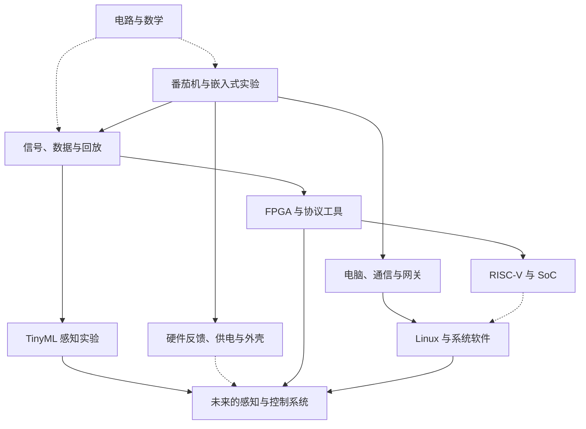

**我们的开放学习路线：从番茄机出发，连接电路、嵌入式、FPGA 与 AI**

初稿日期：2026-09-23。合并更新：2026-09-24。本文保留番茄机、电路、数学、嵌入式、FPGA 与 AI 的开放方向，并纳入你最新提供的本地版本与实机实验记录。它记录当前所在的位置与可选入口，后续可以随兴趣、时间、实际问题和设备变化更新。

本次进度以你提供的本地核对结果为依据；本次没有重新连接 GitHub 核对远端，也没有接机复测。文中区分已经完成的功能、已有结论的实验、待验证的问题和未来建议。

**我们想逐渐获得的能力，是理解并创造一个能与真实世界交互的计算系统。**

从一个可见的现象出发，既能向下追问电路、信号、时序和内存，也能向上延伸到软件、模型和设备协作。当前最具体的载体是 XIAO ESP32S3 Sense、圆屏和已经做出的番茄机。未来的载体可以改变，探索的问题会继续相连。

“自顶向下建立直觉，自底向上夯实工程”可以落实为：先看见完整功能，再理解其中一个环节，改动一点，观察结果。理论阅读也可以独立推进；一个问题暂时没有实验条件，仍然值得认真理解。

**先把已有进度放在正确的位置。**

| 内容 | 当前可确认的状态 | 对后续路线的意义 |
|---|---|---|
| 日用硬件 | Round Display＋XIAO＋Sense 扩展板；保留麦克风，移除摄像头模组，USB 供电 | 当前声音、交互与计时实验具有现成载体 |
| 日用主线 | 在 Codex 协助下完成，当前 main 与画面版本均为 v1.6 | 后续从现有成果继续，可保留日用版本并独立实验 |
| 已实现功能 | 计时、专注与休息切换、触摸设置、亮度、Idle、Done 统计与清零、设置与统计保存；PDM 麦克风、去 DC 的 RMS／peak、Quiet／Normal／Loud 分级 | 可以沿实际功能学习输入、状态、时间、存储与信号处理 |
| 开发方式 | 仓库采用 PlatformIO 加 Arduino framework | 可以沿用；学习新框架时再考虑独立实验或局部迁移 |
| 本地版本 | main 最新提交为 fc32445（sync v1.6 version and hardware notes），工作区干净；本地 origin/main 记录指向同一提交 | 这是你本次报告的本地状态；远端实际状态未重新联网核对 |
| 摄像头 v1.7 | 独立实验分支，未合入日用主线；已初始化、单帧拍摄并做发热观察，留下结论 | 已有实验成果；后续排查可选，视觉方向暂不作为近期必做任务 |
| 硬件反馈 v1.8 | 蜂鸣器／振动反馈仍在规划，尚未实现 | 文档对齐后可选择的一项小扩展 |
| 电路阅读 | 已讨论前五章，第六章已有完整学习笔记 | 继续阅读，也能随项目问题回看相应章节 |
| 数学与 ML | 已接触函数、线性代数、RMS、傅里叶直觉、预测与损失等 | 可逐渐与实际采样数据和简单模型连接 |
| FPGA、RISC-V、Linux、Physical AI | 已有兴趣、资料与方向讨论 | 属于可以逐步进入的分支，尚不能视为已经完成的实践 |

项目功能已经存在，与自己理解到什么程度，是两份不同的进度。后续既可以继续借助 Codex 搭建，也可以挑选关键环节亲自解释、修改、验证。

版本记录帮助我们找到当前位置，不代表所有学习必须依版本号依次进行：

| 阶段 | 已完成的内容 | 所在位置 |
|---|---|---|
| v1.0～v1.3 | 番茄钟、设置、亮度、休息提示、Idle、Done 统计与清零 | 已进入日用主线 |
| v1.4～v1.5.1 | Settings 误触修正、Save／Reset 分离、计时连续性、实机稳定性验证 | 已进入日用主线 |
| v1.6 | PDM 麦克风、去 DC 的 RMS／peak、声音强弱分级 | 当前日用主线 |
| v1.7 | 摄像头初始化、单帧拍摄、发热观察；据实机反馈停止后续高负载测试 | 独立实验分支，未合入主线 |
| v1.8 | 硬件反馈，具体器件和实现待确定 | 尚未实现，近期候选 |

**已经解决的问题，也成为地图中的学习入口。**

| 现象 | 已知处理结果／当前边界 | 可以深入的问题 |
|---|---|---|
| Settings 连点被当作长按，意外退出 | 增加明确的 Save；Settings 内忽略长按，你已回报操作正常 | 输入事件怎样依当前页面解释，消抖与长按识别怎样配合 |
| Save 重置倒计时，偶尔跳到 Break／Idle | 修正时间基准与当前 session 的保存；只改亮度保留倒计时，改 Focus 按已确认规则调整，Reset 才重新开始一轮 | 时间基准、状态保存、设置变更与计时状态的边界 |
| Bright 数字变化但屏幕亮度不变 | 调整 Round Display 背面 KE 开关连接状态后正常 | 软件输出怎样经过实际硬件连接产生效果 |
| 麦克风固定异常值 | 当时整块 Sense 扩展板被移除，麦克风也随之移除；装回后恢复动态采样 | 先确认信号源与硬件组合，再检查算法 |
| Normal／Loud 跳动、说话容易触发 Loud | 加入去 DC、门槛与消抖调整，你最后确认可用；当前只能表示声音强弱，不能可靠识别来源 | RMS、peak、采样窗口、判断稳定性与响应速度 |
| 摄像头发烫 | 可以初始化并拍一帧；保持初始化时你报告热感达第 3 级，随后停止高负载测试；日用移除摄像头 | 热感是观察记录，尚无损坏结论；初始化、取帧与供电状态需要分别确认 |
| 串口曾出现 I2C 读取错误 | 本次没有接机复测，是否仍出现未知 | 记录出现条件，结合触摸、显示与其他 I2C 操作定位 |

“热感第 3 级”保留为当时的主观分级，不换算成未测得的温度。散热片一直未使用是已知条件，尚不能单凭这一项归因。

仓库文档还有收尾：你报告 README 仍将做过的麦克风／摄像头测试列为未来工作，docs/roadmap.md 仍写“目前 v1.5”。历史 tag v1.6-microphone-test 指向 b033798，其中画面仍显示 v1.5；fc32445 才修正为 v1.6。保留历史 tag 并补充说明，可以同时维护过程与当前状态。

本文件是已经合并更新的学习地图。电脑本地仓库中的 README 与 docs/roadmap.md 尚需在该仓库内同步；更新这张地图不等于已经修改了那些文件。

**整个方向更像一张有交叉连接的地图。**

下面的箭头表示知识或项目可以怎样衔接，不表示必须完成前一项才允许接触后一项。

番茄机、声音实验和逻辑分析仪之间有很多可以重复使用的内容：输入事件、缓冲区、时间戳、通信协议、显示、数据文件和调试方法。各项目不必都塞进同一份固件；它们可以共享经验、工具和部分模块。

**番茄机继续承担日常设备与嵌入式练习的角色。**

已有代码提供了具体入口：

| 想理解的现象 | 可从哪里开始 | 可做的一点变化 |
|---|---|---|
| 触摸怎样变成开始或暂停 | `input.cpp`、`main.cpp` | 记录一次触摸从读取到事件处理的过程 |
| 倒计时怎样跟随时间推进 | `pomodoro_timer.cpp` | 观察刷新变慢时计时是否仍能跟上 |
| 设置为何掉电后还在 | `config.cpp`、`stats.cpp` | 修改一个设置，观察保存、重启和恢复 |
| 页面和计时怎样配合 | `main.cpp`、`ui.cpp` | 增加一个简单状态显示，观察交互 |
| 声音为何被判为 Loud | `microphone.cpp` | 同时显示 RMS、峰值和判断结果 |

这些是阅读入口，不要求一次读完整个仓库。一个下午只追清“一次短按经过了哪些函数”，就已经是有价值的学习。

在此基础上，C/C++ 可以按需要补：变量与类型、条件与循环、函数、数组、结构体、枚举、指针、位操作、变量生存期、栈与堆。比如先理解 `remaining_seconds`，再理解模块间如何共享或传递状态；遇到采样数组时，再学习索引、长度和内存边界。

PlatformIO 是项目与构建工具，Arduino 和 ESP-IDF 涉及框架层，三者不构成必须逐级通关的台阶。现有项目可以继续使用 PlatformIO 加 Arduino。任务调度、驱动配置或内存分配成为真正的问题时，可以用独立小工程学习 ESP-IDF，再判断是否需要迁移。

FreeRTOS 的任务、队列、同步与优先级，也适合由实际现象引入：为什么读麦克风时触摸响应慢？采集和绘图如何交换数据？多个任务访问同一份状态如何协调？增加任务本身并不自动改善问题，改前改后的观察更有意义。

**v1.8 可以从一次简单的硬件反馈开始。**

这是近期候选，尚未实现，也不构成进入其他分支的门槛。先按实际已有器件与兴趣，在蜂鸣器和振动器中选一种。一个足够小的初版是：Focus 完成时产生一次短提示，设置中可以关闭反馈。

| 想观察的行为 | 设计时需要弄清的事情 | 可以借机学习的知识 |
|---|---|---|
| Focus 完成时只提示一次 | 在状态转换时产生事件，避免每次刷新重复触发 | 状态机、事件、重复处理 |
| 提示期间仍能触摸和刷新 | 反馈的开始与停止按时间管理 | 非阻塞定时、任务协作 |
| Save、Reset、换页行为清楚 | 反馈与现有计时规则怎样衔接 | 模块边界、状态一致性 |
| 实际器件正常响应 | 确认器件型号、额定条件、驱动方式与供电 | GPIO、负载、电流、开关器件 |

具体接线以实际器件资料和现有板卡引脚占用为准，等型号确定后再设计。第一轮先观察输出与计时事件的配合；提示模式、触摸确认反馈和其他体验功能可以以后添加。

下一次接机时也可以复查 I2C 日志。如果错误仍然出现，就把触发场景记录下来并先定位，方便区分已有问题与新增器件带来的变化。

电池、外壳与电源测量可以随后独立展开；是否投入由实际使用体验决定，不要求与 v1.8 同时完成。

**一条很适合现在延伸的分支，是声音与数据实验。**

v1.6 已经完成 PDM 采样、去 DC 的 RMS／peak 与分级显示，可以直接从现有代码和现象往下研究。下面列的是进一步的实验建议；电脑曲线、文件录制、回放、频谱和声音来源分类尚不能视为已经实现。

这条分支可以由浅到深生长，每一层都有可以保留的成果。

| 小实验 | 可以得到什么 | 自然引出的知识 |
|---|---|---|
| 输出声音特征 | 时间戳、RMS、峰值、读取耗时 | 数据格式、采样窗口、时间单位 |
| 电脑画图并保存 | 一条可回看的曲线和 CSV 文件 | 串口、Python 或浏览器、绘图 |
| 捕获一段原始声音 | 可重复使用的音频样本 | PCM、连续采样、缓冲区、文件格式 |
| 同一段声音反复回放 | 公平比较不同阈值和算法 | 实验复现、参数与结果的关系 |
| 看频谱或时频图 | 观察声音组成随时间的变化 | 傅里叶、FFT、窗口、频率分辨率 |

现有麦克风模块已经计算特征，但连续音频录制仍是一个需要设计和验证的新能力。连续采样时，要关心数据从哪里来、有没有丢失、缓存能放多少、传输与绘图能否跟上。

这里很适合把三个简单关系算清楚：

\[
T_{\mathrm{window}}=\frac{N}{f_s},\qquad
B_{\mathrm{raw}}=f_s C b,\qquad
M=N C b.
\]

其中，\(N\) 是每个通道的采样点数；\(f_s\) 是采样率，单位为每秒采样点数；\(C\) 是通道数；\(b\) 是每个采样点的存储字节数。窗口时长 \(T_{\mathrm{window}}\) 的单位是秒，原始数据率 \(B_{\mathrm{raw}}\) 是字节每秒，内存量 \(M\) 是字节。这些是未压缩数据的估算，不包含协议、文件头和额外缓冲区的开销。

例如 16 kHz、单通道、16 位 PCM 按每个样本 2 字节存储，原始数据率约为 32,000 字节每秒。这个计算能帮助判断缓冲与传输需求，并不意味着现有串口配置已经足以连续传输；文本化输出还会增加开销。

增加一个内部状态页也很有用：记录麦克风读取耗时、屏幕刷新耗时、主循环最长间隔和可用内存。这样以后讨论调度、性能与卡顿时，可以回到具体证据。

**电路阅读和数学会持续陪着项目走，也保留独立阅读的乐趣。**

《The Secret Life of Circuits》继续作为理解物理与电路的主线。前几章涉及的导电、半导体、电压电流、变化的信号、储能和传播，都能逐渐找到工程对应。

| 项目里遇到的问题 | 值得回看的内容 |
|---|---|
| 为什么器件发热、供电会掉压 | 功率、损耗、电源与热量的关系 |
| 为什么 GPIO 信号不能代表足够驱动能力 | 电压、电流、负载和开关器件 |
| 为什么声音平均值很小却听起来很响 | 波形正负变化、RMS、峰值和直流偏置 |
| 为什么响应需要时间、为什么相位变化 | 电容、电感、变化率、储能与滤波 |
| 为什么导线长度、接地和边沿影响通信 | 传播延迟、回流、反射与信号完整性 |

摄像头、麦克风和通信协议不必都在书中找到一模一样的例子。我们会把原书内容、工程补充与尚待验证的推测分清楚。

数学按用途形成几组相互连接的工具：

| 数学内容 | 直觉入口 | 可以连接的实验 |
|---|---|---|
| 函数、单位与比例 | 输入变化时输出怎样变化 | 时间换算、传感器标定、数据率估算 |
| 三角函数、周期、相位 | 同一个运动怎样对应曲线 | 呼吸圆、正弦波、PWM 与周期信号 |
| 平均值、方差、RMS | 一段数据整体有什么特征 | 声音强弱、噪声、特征比较 |
| 导数与积分 | 变化有多快、累计了多少 | 波形斜率、电容电感、能量累计 |
| 复数与频域 | 幅值和相位怎样一起描述 | 阻抗、滤波、傅里叶与频谱 |
| 向量、矩阵、点积 | 多个数怎样共同表示和变换 | 多传感器数据、图像、线性模型 |
| 概率与统计 | 数据有变化时怎样判断 | 分类误差、采样偏差、模型评估 |
| 梯度与优化 | 参数怎样根据误差调整 | 从小函数训练逐渐进入神经网络 |

不把“先学完整套数学”设成项目门槛。遇到一个公式，就补齐定义、变量、单位、适用条件、直觉、图形和一个小例子；有兴趣时再追推导。可视化应把同一份数据在时间域、特征和结果之间联系起来。

**TinyML 可以提前体验，并逐渐加深。**

机器学习的实践线索是：收集数据，给出标签，选择表示方式，训练模型，用未参与训练的数据检查，部署后继续观察。

声音是目前比较顺手的入口。可以先收集两三类声音，建立现有阈值方法的结果，再尝试简单分类器。一个小型模型若不能改善所关心的问题，就保留更简单的方法，同时研究它为什么没有改善。

需要慢慢理解的词包括：样本、特征、标签、参数、预测、损失、训练集、验证集、测试集、误判和泛化。训练与推理是不同工作；模型可以先在电脑训练，之后部署到 MCU，具体工具链等实验目标确定后再选。

音频评估时，尽量按不同录制段或不同录制场景留出测试数据。把同一段录音切成很多几乎相同的片段，再随机混进训练与测试，可能让结果显得过于乐观。图像也要留意背景、光照、拍摄时段与物体位置。

分类分数不自动等于可靠的现实概率；激活热图可以帮助观察模型内部响应，但不足以独自证明模型依据了正确因果特征。我们会把它们与新样本测试一起看。

视觉分支可参考 `webmcu-vision-web` 的采集、训练、导出与部署结构。其配套固件涉及特定扩展板外设，圆屏番茄机需要适配，不能把参考项目的演示结果直接当成我们这套硬件的保证。

摄像头 v1.7 已留下初始化、单帧和发热观察记录；温升原因仍未确认。当前日用组合保留 Sense 扩展板及麦克风，只移除摄像头模组。近期可以继续声音 TinyML；视觉分支留在地图上。

将来决定重启视觉实验时，先回看 v1.7 的条件与结果，再确认实际型号、热源位置、运行程序和安装空间，设计可比较的观察或测量。保持初始化时的第 3 级热感已经是停止后续高负载测试的依据，本次不把继续高负载运行列为下一步。未用散热片是一个线索，尚未证明它解释了全部问题。软件里不调用摄像头、停止取帧和实际切断供电也不能默认等同，相关状态要结合驱动与硬件确认。

**电脑、浏览器和网关让小设备成为更大系统的一部分。**

下面的 Wi-Fi、Gateway 与 AI 交互仍是规划方向，尚未实现；可以从本地数据工具或单一事件开始，按需要逐步扩展。

第一种用途是数据工具：接收曲线、保存实验、回放数据、发送参数。可以用 Python，也可以用支持相应接口的电脑浏览器；选最适合当次任务的方式。

第二种用途是桌面协作：电脑编译结束、脚本运行结束或任务失败时，圆屏显示一个明确状态。先有一条真实事件，再决定是否需要完整网页或后台。

第三种用途是联网系统：Wi-Fi 状态、事件上报、日志与远程命令。进一步可以选择 HTTP、WebSocket 或 MQTT，不需要把几种协议全部同时引入。网关需要保存历史记录或协调设备时，再加入数据库、设备管理和队列。

本地计时应能在联网失败时继续工作。外部发来的命令，需要由本地状态判断怎样执行：例如当前在设置页时收到开始命令如何处理，重复命令是否产生重复效果，断线重连后状态如何对齐。

这里有两种不同的 AI 用途：

| 路线 | 输入和输出 | 主要探索的问题 |
|---|---|---|
| 端侧 TinyML | 声音、图像、传感器数据进入小模型，输出类别或数值 | 数据表示、模型误差、部署和资源限制 |
| 网关 AI 交互 | 用户意图或文字进入电脑／服务端模型，输出说明或结构化命令 | 交互、协议、状态同步与执行边界 |

两者可以独立学习，将来再组合。XIAO 可以负责物理输入和反馈，电脑或其他平台承担适合它的处理工作。

**FPGA 保留为重要分支，入口可以从仿真开始。**

重点是理解“寄存器与组合逻辑怎样在时钟约束下工作”。适合的材料包括逻辑门、多路选择、寄存器、计数器、状态机、复位、同步和波形。

几个可以独立完成的小作品：LED／计数器、PWM、UART 发送器、UART 接收器、小 FIFO、简单 SPI 从机。每次可以先在仿真中看波形，再在需要时上板验证。仿真有助于检查逻辑；真实输入、电平、布线与时序还需要实物验证。

逻辑分析仪仍是很好的综合作品。可以从一个可控的测试信号或一个通道开始，记录有限长度波形并传到电脑，再增加触发、更多通道和协议解析。第一版不预定固定高采样率，具体目标取决于输入信号、板卡、存储和传输能力。

一个常见的分工方式是：FPGA 采样和缓存，MCU 配置、显示或转发，电脑绘图和解析。协议解码也可以先放在电脑；是否移入 FPGA，应由实时性需求和学习兴趣决定。

“协议实验器”可以给这条路增加可视化：用已知字节观察起始位、数据位、停止位与采样时刻；改变参数后，解释错误如何产生。后续出现多个时钟域时，再深入 FIFO、CDC（跨时钟域）、亚稳态、时序约束与静态时序分析。

**RISC-V 和 Linux 提供两种进一步理解系统的视角。**

RISC-V 是指令集方向，FPGA 是构建数字电路的一种平台。学习寄存器、指令、栈、函数调用、异常和中断，可以先从模拟器或现成系统开始。想亲手构建处理器系统时，再尝试软核、RAM、UART、GPIO 和总线。

一个能运行裸机程序的小软核系统，与能运行完整 Linux 的系统之间还有架构与资源要求。PicoRV32 小实验不应被自动等同于“下一步就能启动完整 Linux”。

Linux 则可以较早作为电脑上的工具来用：命令行、文件、进程、串口、Python、编译和 Git。对系统调用感兴趣，可以用一个很小的程序观察读写文件的过程；没有必要等到自己做出 CPU 后再开始这些探索。

内核与驱动可以从具体问题逐步深入：程序怎样访问串口，为什么需要系统调用，虚拟地址怎样映射，中断怎样通知软件，设备树怎样描述硬件。以后再进入页表、TLB、调度、驱动框架与源码。严格的实现细节要对应具体处理器与操作系统，不能把一个架构的术语直接套到全部平台。

**Physical AI 保留为开放的长期方向。**

我们关心的基本关系是：感知环境，作出判断，执行动作，再观察动作带来的变化。它可以从很小的传感器与执行器实验开始，逐步进入视觉、运动、通信和控制。

MCU、FPGA、Linux SoC、GPU 或 NPU 是不同的工具。只有实际任务需要多种处理能力时，再研究怎样分工。Jetson、TI 等平台可以作为届时候选；ROS 2、本地模型和更复杂的机器人软件也由具体项目引入。

进一步做实时控制时，需要明确周期、延迟、抖动与故障时的行为；用了 RTOS 或 FPGA 并不自动证明系统满足要求。机械、电源与驱动方面的问题会逐渐进入学习范围，每次增加一小块即可。

**已经讨论过的其他兴趣也有位置。**

LoRa／Meshtastic 可以作为无线通信与低功耗分支；外壳、供电与电池可以作为设备产品化分支；圆屏动画、专注星球和呼吸圈可以作为图形与交互分支；AST 小工具可以作为理解代码结构的分支；概率、Markov、Monte Carlo 等可以作为数学探索分支。

这些不需要全部在番茄机里实现。一个分支可以先做一次独立实验，积累了有用经验再决定是否合并。无线频段、功率、硬件型号和软件兼容性等会变化的条件，在实际实施时按所在地与具体版本查证。

**灵活性落实到每次如何选择下一件事。**

可以保留一个正在做的项目、一条随时可读的理论线，以及一张兴趣清单。数量只是帮助减轻负担的参考，有余力时可以并行，累的时候也可以只读书或整理现象。

| 当下状态或兴趣 | 可以选的入口 |
|---|---|
| 时间少，想轻松一点 | 看懂一个变量、一条日志、一页书或一张图 |
| 想看到明显变化 | 改一个画面、声音阈值或交互细节 |
| 想把数学联系起来 | 对同一段声音画波形、RMS 和峰值 |
| 想碰 AI | 收集少量带标签的数据，比较简单方法 |
| 想碰 FPGA | 在仿真里观察计数器、UART 或 FIFO |
| 想理解操作系统 | 观察一个文件读写程序的系统调用 |
| 硬件暂时不方便 | 用已保存的数据回放、写小脚本或做仿真 |
| 某个问题卡住 | 缩小范围、保存现象，暂时换一个可继续的入口 |

一个小实验只需有一个清楚的问题。例如“调低阈值会不会让安静房间也被判成 Normal”。改之前作一个预测，改之后观察差异，留下几句记录。结果不符合预测时，正好获得下一个问题。

可以用五行记录帮助以后接续：

- 我想知道什么。
- 我这次改变了什么。
- 我原先预计会怎样。
- 实际观察到了什么。
- 下次最想继续看哪里。

不需要每次写成报告，也不需要通过一套题目才能继续。能更准确地描述现象、预测一项改动、解释一张图、找出一个失败条件，都是进步。一个实验做到自己已经满足好奇心，也可以停在那一层。

**Codex 与我们的对话可以分担不同工作。**

Codex 可以帮助查找代码、搭框架、修改局部功能、解释报错、补有意义的验证和整理改动。你可以决定目标、操作实物、选择要理解的部分，并观察代码与现实的差别。

比较适合的协作请求是：“这一轮只增加时间戳和 RMS 输出，解释数据从采样到串口的路径，说明我怎样在设备上观察。”这类请求范围清楚，也便于定位改动。

已有版本能日常使用时，实验可以放在独立分支或小工程中。保存版本是为了方便回来；版本号不承担学习分数的作用。实机测试由真实设备提供证据，AI 不能代替实际测量和操作反馈。

**硬件和资料按实际用途进入。**

现在没有一张必须照买的长期清单。遇到测量、连接、供电或采集的真实需要，再决定增加什么。选择 FPGA 或 Linux 板时，届时再看接口、工具、文档、例程、可获取性与预算，不把品牌和型号排成固定升级阶梯。

资料也按问题查阅。电路书持续读；数学资源用来解释具体困惑；FPGA 书籍和官方例程随着实验深入。价格、性能和版本信息在准备使用时核实，避免把旧讨论中的数字当作长期不变的事实。

**眼前的一条可选路径，可以小到这样。**

现在已经确认了日用版本，可以先完成一个收尾：在电脑本地仓库内同步 README 与 docs/roadmap.md，使它们准确区分 v1.6 日用成果、v1.7 实验结论、v1.8 候选与待复查问题。历史 tag 的差异通过说明保留，不把它误写成当前 main 仍有版本显示错误。

接下来可以从下面的入口里选一件最想做的事：

| 现在更想做什么 | 可以立即接续的方向 | 与其他方向的连接 |
|---|---|---|
| 让番茄机在使用时更有反馈 | v1.8：一种器件、一个事件、一次短提示 | 状态机、非阻塞定时、负载与驱动 |
| 把数学与已经工作的代码连起来 | 追一段麦克风数据怎样去 DC、计算 RMS／peak、变成分级 | 统计、信号、阈值与响应速度 |
| 在电脑上看到声音如何变化 | 增加时间戳和特征输出，再绘图与保存 | 通信、数据格式、后续回放与 TinyML |
| 认真读书或轻松探索 | 从已有第六章笔记接续，或选择 FPGA 仿真、图形、Linux 小实验 | 保持理论与其他兴趣的独立入口 |

这些入口可以互相切换。摄像头以 v1.7 记录保留；电池、外壳、Wi-Fi、Gateway、AI 和逻辑分析仪继续作为待实现的方向。没有固定月份，也不因一个分支暂时停下就中断整条路线。

为了以后能接续，只需维护一小段当前状态：

- 正在用：v1.6，main／fc32445；圆屏＋XIAO＋Sense 扩展板，麦克风保留，摄像头移除，USB 供电。
- 最近实验：v1.7 初始化、单帧与发热观察；独立分支，未合入主线。
- 尚未确认：I2C 读取错误是否仍出现；摄像头温升的原因；远端最新状态未在本轮重新联网核对。
- 最近收尾：同步本地仓库文档与历史 tag 说明。
- 下一件候选：v1.8 硬件反馈，也可按兴趣转向声音数据与数学。

版本状态以后随真实改动更新；其余方向留在地图上，等兴趣或需要把它们重新点亮。

**本次整理依据与入口**

- 2026-09-24 你提供的本地核对与实机反馈汇总：main／fc32445、画面 v1.6、工作区干净、本地 origin/main 同提交；v1.7 独立实验与 v1.8 未实现状态。这是本次进度更新的直接依据。
- [番茄机仓库](https://github.com/iankirkpa5-hash/xiao-pomodoro-companion)：初稿曾查看 v1.6 快照；本次依据你的本地报告更新，没有重新联网核对远端。
- [番茄机原路线图](https://github.com/iankirkpa5-hash/xiao-pomodoro-companion/blob/main/docs/roadmap.md)：保留联网、网关和桌面 AI 伴侣方向；按你本次报告，该文档的当前版本描述仍待在仓库内更新。
- [分享对话：分支 · FPGA 内部架构解析](https://chatgpt.com/share/6ab32f51-f6b0-83ea-9cc6-0194928c01d9)：系统学习方向和 TinyML 等分支讨论。旧回答中的固定时间表和未经验证的推断不作为约束。
- 已有笔记 `circuits_learning_handoff.md` 与 `chapter-06-complete-notes.md`：用于确认读书进度与解释要求。
- [webmcu-vision-web](https://github.com/webmcu-ai/webmcu-vision-web)：视觉数据采集、浏览器训练和部署的参考结构。
- [Seeed 关键词识别教程](https://wiki.seeedstudio.com/tinyml_course_Key_Word_Spotting/)：音频 TinyML 的参考入口，实际使用时核对工具版本与硬件配置。
- [Seeed XIAO ESP32S3 入门文档](https://wiki.seeedstudio.com/xiao_esp32s3_getting_started/)：硬件、散热与基础配置的官方参考。

文中“已完成／已有结论”的状态以开头的版本与问题记录为准；其他作品、实验和扩展均为建议，不代表已经实现、性能已经验证或已经作出采购决定。
