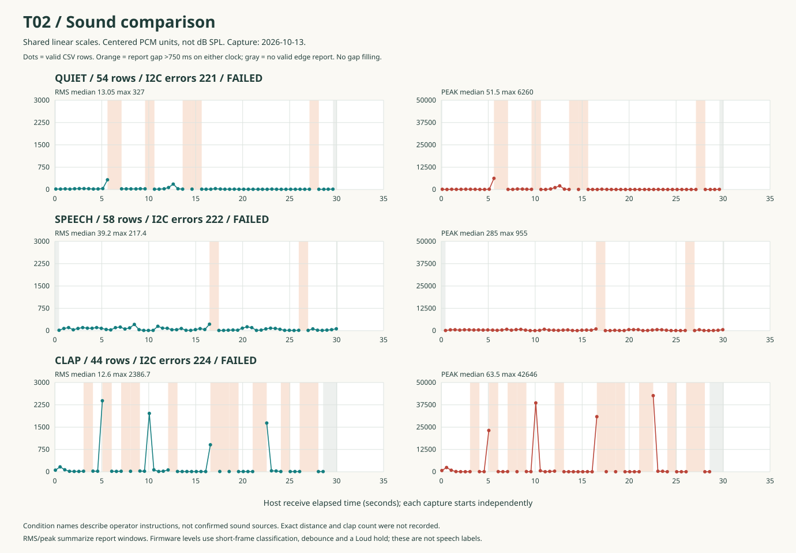
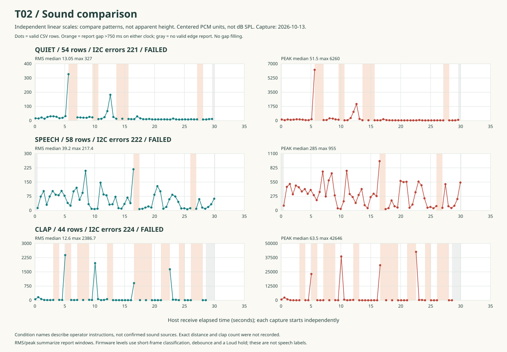
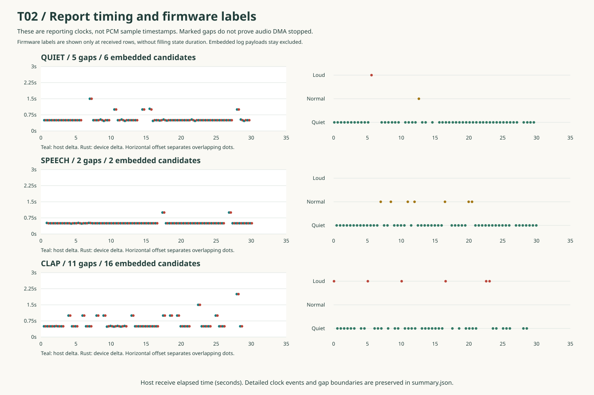

# T02 Sound Comparison

Date: 2026-10-14 (Asia/Shanghai). Analysis of the October 13 saved captures.

## Result

The offline T02 comparison is complete. The three datasets are plotted and
reconciled with their original logs and capture reports. **Hardware acceptance
is still incomplete:** all three original reports remain FAILED due to I2C
errors. No firmware, threshold, Settings, NVS, or hardware configuration was
changed, and no build, upload, or new serial capture was performed in this step.

The main new finding is **interleaved serial output**: some microphone records
appear inside I2C error lines. The capture parser correctly rejects those lines
as measurements. This explains the observed missing CSV reports without proving
that PCM acquisition stopped. Investigate this before tuning sound thresholds.

## Evidence and Conditions

Use the [T01 record](2026-10-13-t01-sound-baseline.md) for setup and the user's
observations. The user confirmed following the sound prompts at very close
range. Exact distance, clap count/times, and incidental sounds during quiet
were not recorded. Condition names are operator instructions, not verified
sound-source labels.

| Condition | Local input under `test-runs/` | Valid rows | Embedded payload candidates | I2C errors |
| --- | --- | ---: | ---: | ---: |
| Quiet | `20261013T132241Z-4f4c50f9` | 54 | 6 | 221 |
| Speech | `20261013T132639Z-03888e7a` | 58 | 2 | 222 |
| Clap | `20261013T132928Z-6698a2dd` | 44 | 16 | 224 |

Inputs are `mic.csv`, `serial.log`, and `report.json` in each directory. They
remain local and ignored by Git; cloning the repository does not provide them.
The [analysis audit](assets/t02-2026-10-14/summary.json) retains their SHA-256
hashes, exact outlier rows, clock gaps, mixed-line locations and source checks.
All three capture-time local firmware hash maps are identical. This does not
prove which binary was running: the device has no unique build identifier.

## Curves

The horizontal axis is **computer receive elapsed time**, independently starting
at each capture. Units are centered PCM counts, not sound-pressure decibels.

- Same-scale view compares amplitudes across conditions; small speech changes
  are compressed by the much larger clap peaks.
- Detail view uses a separate, explicitly labeled linear scale for each panel.
  Compare patterns there, not apparent heights across panels.
- Dots are valid CSV rows; orange intervals exceed 750 ms on either reporting
  clock. Lines break rather than interpolate across them. Gray intervals mark
  no valid report at a capture edge. No values are filled with zeros.
- The 750 ms display rule is 500 ms nominal reporting plus 250 ms allowance.
  It is not a new firmware threshold or a change to T01's two-second check.







PNG previews are also provided: [shared scales](assets/t02-2026-10-14/comparison-shared.png),
[detail](assets/t02-2026-10-14/comparison-detail.png), and
[timing / labels](assets/t02-2026-10-14/timing-levels.png).

## What the Numbers Show

These are unweighted distributions of **valid report values**, not an
overall audio RMS or time spent in each state. Per-row sample counts are absent.
No outlier has been removed.

| Condition | RMS median | RMS maximum | Peak median | Peak maximum | Quiet / Normal / Loud rows |
| --- | ---: | ---: | ---: | ---: | --- |
| Quiet | 13.05 | 327.0 | 51.5 | 6260 | 52 / 1 / 1 |
| Speech | 39.2 | 217.4 | 285 | 955 | 51 / 7 / 0 |
| Clap | 12.6 | 2386.7 | 63.5 | 42646 | 38 / 0 / 6 |

Speech has a higher median RMS and peak than quiet in this capture. It does
not continuously produce Normal, and no valid speech row has Loud. These facts
show a response, not reliable speech recognition or a calibrated loudness scale.

Four conspicuous clap-run peaks are present in valid CSV:

| Host elapsed (s) | Device timestamp (ms) | RMS | Peak | Level |
| ---: | ---: | ---: | ---: | --- |
| 5.063 | 2828412 | 2386.7 | 23143 | Loud |
| 10.063 | 2833412 | 1961.5 | 38566 | Loud |
| 16.563 | 2839912 | 907.8 | 30868 | Loud |
| 22.563 | 2845912 | 1637.7 | 42646 | Loud |

This refutes "peak never changes" for this dataset. It does not establish
four claps, a detection rate, or that every requested clap was captured.
The earlier observation on a different dataset cannot be diagnosed solely
from these runs. The current web monitor also auto-scales; a large peak can
make subsequent smaller changes look flat until it leaves the visible window.

Quiet contains an unexplained peak at host **5.609 s**, device **2421762 ms**:
RMS **327.0**, peak **6260**, level **Loud**. At **12.609 s**, another event has
RMS **181.9**, peak **2048**, level **Normal**. Without an event diary or raw
audio, neither can be attributed to an incidental sound, handling, or an
electrical artifact. Do not use this run as a clean threshold-calibration set.

## Report Gaps and Mixed Lines

| Condition | Internal gaps over 750 ms | Largest device gap | Raw candidate count | Raw candidate spacing |
| --- | ---: | ---: | ---: | --- |
| Quiet | 5 | 1500 ms | 60 | 500 ms |
| Speech | 2 | 1000 ms | 60 | 500-510 ms |
| Clap | 11 | 2000 ms | 60 | 500-510 ms |

Every internal valid-CSV gap contains embedded microphone payload candidates
at the missing device times in the original log. For example, clap log line 43:

```text
[2827032][E][Wire.cpp:513] requestFrom(): i2cRead returned Error2826912,16.8,60,Quiet
 -1
```

The microphone-shaped payload is not a standalone line. The existing CLI
checks I2C errors before accepting microphone rows, and the web parser also
does not treat this error-prefixed line as a valid sample. Including these
separate candidates gives 60 payloads per run at approximately 500 ms spacing.
The last two clap candidates are after the last valid CSV row, explaining its
long tail as well as the internal gaps.

**The charts and statistics exclude those candidates.** They have no standalone
record framing, checksum, or independently saved host receive timestamp. The
audit records them for diagnosis, not as silently recovered measurements.
No corruption-free transport or lossless audio claim is made.

All 18 microphone throughput diagnostics across the three runs report zero
read errors and approximately 16,000 processed samples/s. This is a different
counter from the I2C errors. It does not prove DMA continuity. No backward or
duplicate device timestamps were found in valid CSV; unit tests also cover
reset and uint32 wrap handling.

Clap log line 18 additionally contains `Touch: x=152 y=1, running=false`.
The preceding timer log says running=true and later logs say running=false.
There is no matching operator confirmation of a touch. This could be actual
contact or unwanted input; the log alone cannot decide. Keep it as a separate
follow-up rather than declaring touch broken or silently treating it as normal.

## RMS, Peak, and Level Are Different Measurements

The current local microphone source centers each 160-sample frame (10 ms at
16 kHz), then aggregates frame energy and maximum absolute deviation for each
report. The label instead uses short-frame thresholds, debounce, and a 600 ms
Loud hold. A report-level RMS/peak pair cannot reproduce that state history.

For example, the clap run has Loud at 23.063 s with RMS 32.3 / peak 296, shortly
after the 22.563 s high peak. That is consistent with a held label, not proof
of an incorrect instantaneous comparison. The device screen was not observed
simultaneously in T02, so screen/CSV agreement remains a separate manual check.

Centered signed 16-bit deviations can exceed 32767 (up to 65535); peak 42646
alone does not prove overflow or clipping. Raw PCM is needed for saturation,
waveform, frequency analysis, recording playback, or speech recognition.

## Reproduce and Verify

The offline analyzer uses only Python's standard library and never opens a
serial port. From the repository root:

```powershell
py tools/analyze_sound.py `
  --run quiet=test-runs/20261013T132241Z-4f4c50f9 `
  --run speech=test-runs/20261013T132639Z-03888e7a `
  --run clap=test-runs/20261013T132928Z-6698a2dd `
  --output docs/experiments/assets/t02-2026-10-14
py -m unittest discover -s tools/tests -p test_sound_analysis.py -v
```

If `py` is unavailable, use the existing PlatformIO environment's Python.
The command generates three SVGs and `summary.json`. SVGs open directly in a
browser without a server or board; hover a dot for its source row and both
timestamps. PNG files are convenience renders of those SVGs, not separately
computed charts. They are not regenerated by the dependency-free analyzer.

The analyzer fails on unsupported/malformed CSV or mismatched report evidence.
It checks ordered CSV versus standalone raw rows, counts, RMS range, maximum
peak, I2C count, and diagnostic contents. It preserves both clocks, breaks on
gaps/resets/duplicates, unwraps uint32 rollover, and escapes chart labels.
The automated tests use synthetic data and do not certify hardware.

Verification performed this round:

- 11 new offline-analysis tests passed, including invalid data, input mismatch,
  clock reset/wrap, interleaved output, gap evidence, and SVG generation.
- Full Python tool suite: 26 passed; two POSIX serial tests skipped on Windows.
- Existing web telemetry suite: six passed. No browser-to-device test performed.
- All three rendered charts were visually inspected; all local document links
  in the updated T02 documents were checked.
- The nine source artifacts remained unchanged. All firmware files and
  `platformio.ini` still matched T01's recorded source hashes.

For later live observation, reuse the existing
[web monitor](../../tools/microphone-monitor/README.md). It is not rewritten
here, and no second serial reader was opened. The offline figures read the
CLI's saved output, satisfying the T02 alternative to a new live plotter.

## Next Single Investigation

1. Preserve these raw captures and the existing firmware baseline.
2. Investigate why I2C diagnostics and application records interleave on USB.
   Verify one complete telemetry record is transmitted intact before changing
   audio thresholds. Keep I2C errors visible; suppressing logs is not a repair.
3. Compare the same 30-second captures after one targeted change: standalone
   row count, mixed-line count, spacing, and audio response. Separately check
   I2C cause and the unexpected touch record.
4. Then run T03's full build/upload/capture and manual regression checks. Raw
   PCM/WAV and AI remain separate later experiments, not part of this result.

T02 delivers offline curves and a testable explanation. T01 hardware acceptance,
live screen/CSV comparison, I2C resolution, and PR acceptance remain open.
